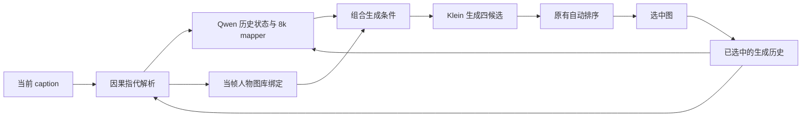

# 两条 baseline 的实验协议

## 合同指标版 raw best4

固定输入为发布清单中的 865 个 test 故事，每个故事四帧。实际生成 caption 从 `cleaned_annotations.json` 读取原始描述，不用故事清单里可能带指代替换的 caption。

每帧按当前文字中显式出现的人名绑定固定图库，没有历史图片、历史 caption 或 mapper。Klein Base 加载 D1 的 C0 25k LoRA 与 B 26k 融合层，512×512、32 步、guidance 4.0。原生文本长度向上取 128 的倍数，超过 512 token 时拒绝截断；既有完整 test 的实际长度均为 128。

种子沿用历史规则：`20260916 + story_index*4 + position`；属于原 87-story 子集的故事使用该子集中的索引。候选 1–3 分别比候选 0 增加 `1_000_003` 的整数倍，限制到前 N 个故事时不重新分配种子。

排序分数为 `0.45 * character + 0.25 * background + 0.30 * visual`。前两项来自分类器对生成图的预测及当前 caption 中提取的角色／场景目标；visual 是 Qwen 对 identity、cast、background、action、quality 五个 0–4 分的平均归一化值。Qwen 读取候选图及指定人物参考，采用原提示词、两图批大小和最多 256 个新 token。

并列选低编号；解析失败保留该候选并给 visual 中性分 0.5；不按真实标签选图，不通过重抽掩盖失败。single 视图固定使用 candidate 0。

## 原始历史续写版

本包 `history_best4` 采用 2026-10-04 冻结的自动当帧图库流程，参数与 2026-10-09 的 pilot baseline 一致。使用 C0 25k 的 LoRA 和融合层，搭配该人物模型训练得到的 8k mapper。

首帧读取当前描述及固定人物图库。后续帧使用本故事此前已经选中的生成图与对应原始 caption；Qwen 自动解析当前句的指代，生成端通过 mapper 获取历史条件，再加上当帧命名人物的图库融合增量。改写超出 128 token 预算时沿用冻结流程的原句回退行为。四选一后仅将选中图送入后续历史。

原始 64-story 开发组使用 referring captions，固定 256 帧。更早的“仅首帧图库 causal_best4”是另一条实验，历史 76.17%／71.48% 不属于本包 `history_best4` 的 91.41%／70.31% 这一行。这里明确保留当前 `kuadu` baseline 的当帧图库行为。

## 20 case 跨度实验

`pilot` 使用外部交接的原 `inputs/cases.json`，保留每个 case 的原始文本、片段顺序和种子。

| 分支 | 每 case 帧数 | 全部逻辑帧 | 历史 Char Acc % | 历史 BG Acc % |
| --- | ---: | ---: | ---: | ---: |
| short_contextual，相邻五片段 | 5 | 100 | 84.00 | 65.00 |
| long_stride8，间隔八片段 | 5 | 100 | 84.00 | 62.00 |
| short_storygptv，四片段缓存 | 4 | 80 | 83.75 | 71.25 |

三条分支共用每 case 的同一张自动选中首帧，之后分别维护自己的历史。总计 280 个评价位置，但只做 240 次独立帧生成，共 960 张候选。不能将共用首帧当作三次独立生成。该小样本测试与 raw 的完整 test 采用不同输入范围和历史条件。

## 指标与失败处理

Char Acc 是 7 维角色出现向量逐帧完全相等的比例；BG Acc 是 323 维背景向量逐帧完全相等的比例。F1 是所有帧所有标签的 micro-F1。

raw 最终评分沿用 `torch.round(torch.sigmoid(logits))`；历史在线分类与原 pilot 汇总沿用 `p > 0.5`。在恰好 0.5 时两者均判为 0。评价器为 float32 Inception-v3，预处理保持 bilinear Resize(299)、CenterCrop(299)、ImageNet 标准化和 `transform_input=True`。

评分以全部计划帧为分母，显式标记缺失的生成不因标签为空而算正确。raw 构建 best4 视图要求完整候选池；不完整池直接报错。发生异常时保留已产生的结果，先看工作进程报错，再决定新建运行目录或继续尚未执行的独立阶段。

原始出处使用相对项目位置记录：

| 汇总文件 | 原始出处 |
| --- | --- |
| `results/raw_single.json`、`raw_best4.json` | `QwenAnimeBaseline/outputs/flintstones_klein_inference_search_20260921/run_001/full_test/views/{single,best4}/result.json` |
| `results/history_256.json` | `QwenAnimeBaseline/outputs/flintstones_text_reference_factorial_20261004/run_001/rollout_256/result.json` 的 current 与分位置字段 |
| `results/pilot20.json` | `kuadu/baseline-pilot20-stride8/run_001/result.json` 的指标与规模字段 |
